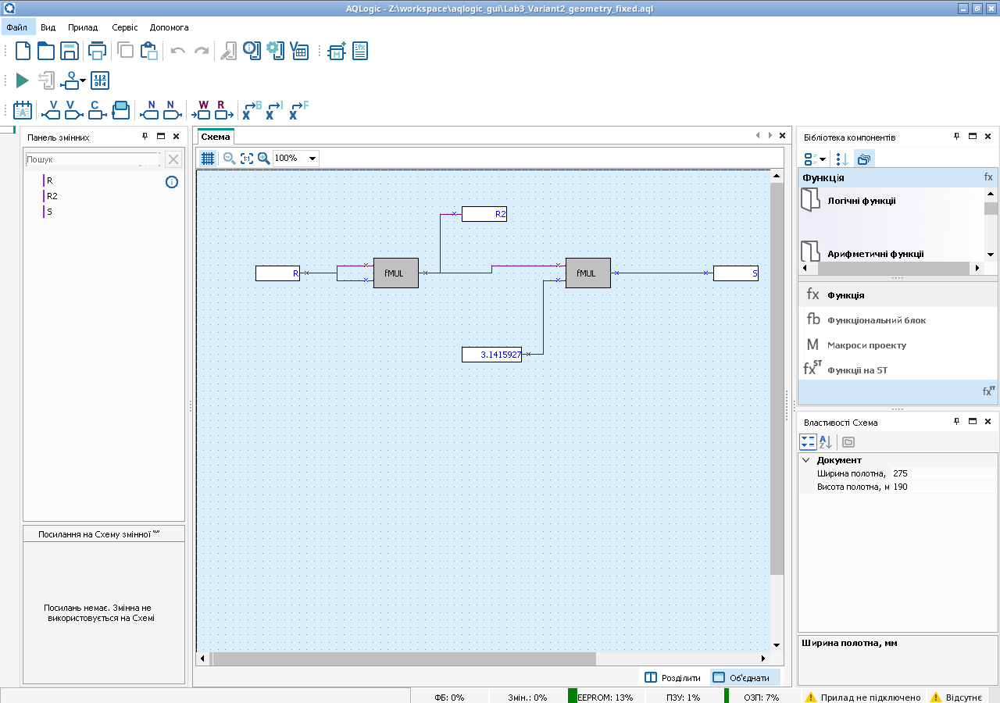

# Лабораторна №3 — варіант 2

Проєкт AQLogic для обчислення площі кола: **S = π × R²**.

**[Завантажити виправлену версію v2](./Lab3_Variant2_PR200_v2.aql?raw=true)**

Версія v2 усуває помилку `VisualyUpdateElementsService.UpdateFont` при відкритті та неправильне розташування блоків. Файл збережено самим AQLogic 2.5.362, повторно відкрито в новому процесі та перевірено в симуляції.

## Як відкрити

1. Повністю закрийте AQLogic після попередньої помилки та запустіть його знову.
2. Завантажте **Lab3_Variant2_PR200_v2.aql** та виберіть **Файл → Відкрити проєкт…** (`Ctrl+O`).
3. На схемі є два блоки `fMUL`, дійсні змінні `R`, `R2`, `S` і константа `π = 3,1415927`.
4. Для симуляції натисніть зелену кнопку входу в режим симуляції, а потім кнопку **▶** на панелі симуляції.
5. Для перевірки задайте `R = 2,5`. Дробове значення в українській локалізації вводиться через кому. Має бути `R2 = 6,25`, `S ≈ 19,635`. На проводах результат може показуватися в науковому форматі `1,96E+01`.
6. Екран **Circle area** розташований у **Вид → Менеджер екранів → Main**. Рядок `R=` призначений для введення радіуса від 0 до 10, рядок `S=` — для відображення площі з трьома знаками після крапки.

Модель приладу: **ПР200-24.2(4).X.X (PR200DCA)**. Перед записом у реальне реле перевірте відповідність моделі та налаштуйте порт.

## Контрольні значення

| R | S |
|---:|---:|
| 0 | 0,000 |
| 0,5 | 0,785 |
| 1 | 3,142 |
| 2 | 12,566 |
| 2,5 | 19,635 |
| 5 | 78,540 |
| 10 | 314,159 |

## Перевірка

Відтворено початкову помилку, виправлено стилі тексту та координати блоків. У Windows-версії AQLogic 2.5.362 через Wine перевірено відкриття, збереження, повторне відкриття та виконання FBD у симуляції. Додатково перевірено всі зв’язки й сім числових прикладів із 32-бітною рухомою комою. На реальне реле програму ще не записували.

